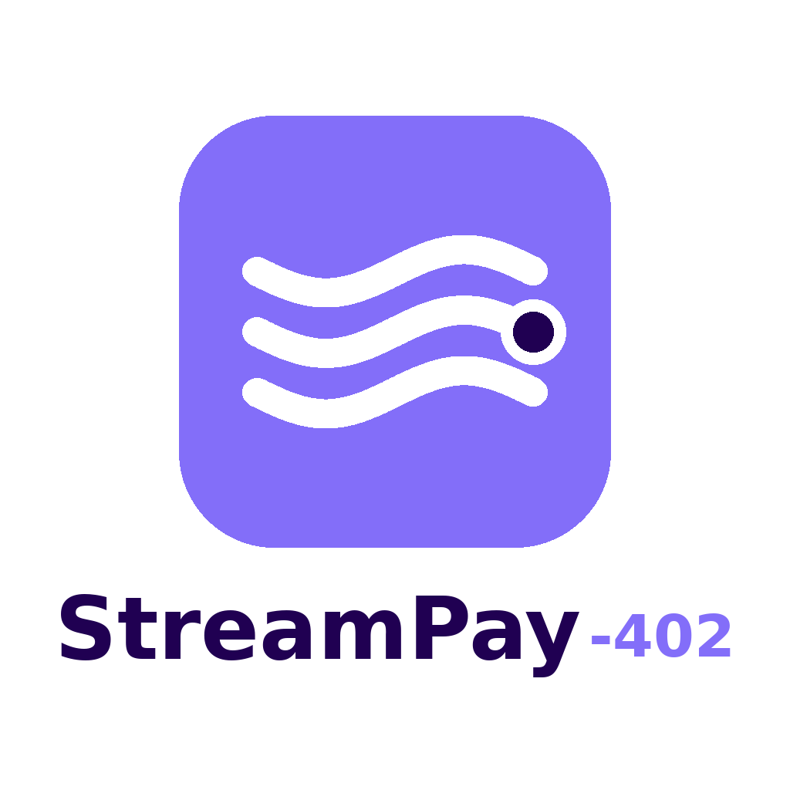
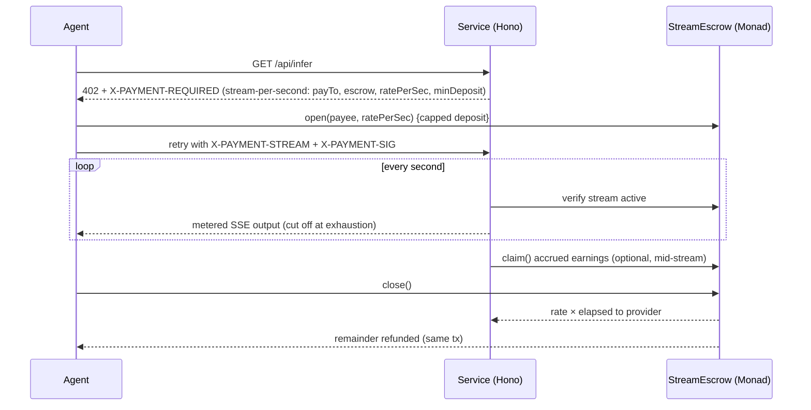

<p align="center"></p>

<h3 align="center">Per-second billing for AI agent services: an add-on scheme for x402, on Monad.</h3>

<p align="center">
  <a href="https://calgary-creativity-creations-courier.trycloudflare.com"><b>Live demo</b></a> ·
  <a href="https://calgary-creativity-creations-courier.trycloudflare.com/onboard"><b>Sign up (/onboard)</b></a> ·
  Demo video: <code>TODO_DEMO_VIDEO_URL</code> ·
  Pitch video: <code>TODO_PITCH_VIDEO_URL</code><br>
  Monad Metropolis · Track: <b>Consumer Products &amp; Payments</b> · Monad testnet (chainId 10143)
</p>

---

## Problem
x402 handles pay-per-request well, but services billed by time (GPU and inference sessions, voice minutes, browser sessions, long agent jobs) still force a bad choice: prepaid credits with leftover balances, or plans that charge for idle time. An agent that rents a GPU for 47 seconds should pay for 47 seconds.

## Solution
StreamPay-402 adds a `stream-per-second` scheme to the x402 402 handshake. The agent opens a capped escrow stream on Monad, the service meters it every second and cuts off when the deposit runs out, and on `close()` the provider gets `rate × elapsed` while the payer is refunded the rest **in the same transaction**. Providers sign up with email, register their service onchain and get Stripe-style keys.

## Try it in 60 seconds
1. Open the [live demo](https://calgary-creativity-creations-courier.trycloudflare.com).
2. Go to [/onboard](https://calgary-creativity-creations-courier.trycloudflare.com/onboard) and sign up with email (Privy creates an embedded wallet).
3. Grab the testnet gas drip, then register a service onchain at a per-second rate. Copy your `pk_test_` / `sk_test_` keys.
4. Open the dashboard and click **Run agent**: watch the 402, the stream open, the per-second cost counter and the close + refund.
5. Click any tx link to verify it on monadscan.

## How it works

Owed is computed from block timestamps only: `owed = min(deposit, rate × (now − start))`. No per-tick signatures, no offchain vouchers. Per-request calls stay on x402 `exact`; it is not a new protocol.

## Why Monad
Per-second settlement only makes sense if opening and closing a session costs less than a few seconds of service. Monad's fast blocks and low fees make `open → use → close` feel instant, so the refund lands before the agent's next step.

## Deployed contracts (Monad testnet)
| Contract | Address | Deploy tx |
|---|---|---|
| StreamEscrow v2 (audited) | [`0x51ff24a5…25eb`](https://testnet.monadscan.com/address/0x51ff24a504b2f7446df1767fea43063d7dd525eb) | [0x560162f0…67b0](https://testnet.monadscan.com/tx/0x560162f0c520ae4fee2e65e886518bbc032639e4aea144a8e4ad6147dfd567b0) |
| ServiceRegistry | [`0xdaeddd6a…a797`](https://testnet.monadscan.com/address/0xdaeddd6a68bbea02c58dd0349797e8847c3fa797) | [0x8ec2e134…fc75](https://testnet.monadscan.com/tx/0x8ec2e134564dda5a1a3dfd6ed0115aa770ab62c2a2650397a60feba9cf5ffc75) |

**Live end-to-end run** (0.001 MON/s, 0.06 MON budget, agent stopped after 12 s):
| Step | Tx |
|---|---|
| Agent opens stream (0.06 MON deposit) | [0x0eafb210…8a34](https://testnet.monadscan.com/tx/0x0eafb210830a49f1eb29f91d9957118be359d1aea856c1d75a2aed018bea8a34) |
| Provider claims mid-stream | [0xccd1ef4f…f4ce](https://testnet.monadscan.com/tx/0xccd1ef4f6784503bca980e3bd1343b551adc2284f63b86ceb18aeebaa0e5f4ce) |
| Agent closes: 0.007 MON more to provider, 0.047 MON refunded, same tx | [0x74135092…8dfe](https://testnet.monadscan.com/tx/0x74135092040817f4d1f82037045790f3e47795c5489f6d35fea9cd1448c78dfe) |

<details><summary>Superseded: StreamEscrow v1 (pre-audit, do not use)</summary>

`0xda46725e9559d87963349570da491a8f08547d27`, replaced by v2 after the H-1 fix.
</details>

## Onboarding
- **Privy** email login → embedded wallet on Monad testnet (injected-wallet fallback), plus a capped testnet gas drip.
- **Onchain registration** in `ServiceRegistry`: `registerService(name, ratePerSec, payee, keccak256(sk))` and `registerAgent(name)`.
- **Stripe-style keys**: publishable `pk_test_<serviceId>` for agents, secret `sk_test_…` generated in the browser and shown once. **Only its hash is stored onchain.**
- Agents discover terms via `GET /api/registry/terms/pk_test_<id>`. Full flow, API and e2e txs: [ONBOARDING.md](ONBOARDING.md).

## Security
Manual audit on Oct 13 2026, full report in [AUDIT.md](AUDIT.md). All High and Medium findings fixed before submission.

<details><summary>Audit summary</summary>

- **H-1** payee can't block `close()`: gas-capped payee leg with pull-payment fallback; payer refund always lands. Redeployed as v2 (tests cover reverting, gas-burning and reentrant payees plus a conservation fuzz).
- **H-2** stream bound to requester via payer signature (`X-PAYMENT-SIG`), one live session per stream.
- **H-3** agent pins the escrow, allowlists payees, caps rate and deposit.
- **M-1** agent always closes. **M-2** server fails closed on RPC errors. **M-3** demo endpoints token-protected, inputs validated, output escaped. **M-4** one provider claim per stream. Plus L-1/L-2/L-4.
- Accepted for the demo: L-3 whole-second granularity; `claim` uses a server hot key.
</details>

## Run locally
```bash
bun install
cd contracts && forge test && forge build && cd ..
# .env: RPC_URL, CHAIN_ID=10143, PAYER_KEY, PAYEE_ADDRESS, REGISTRY_ADDRESS, PRIVY_APP_ID
bun src/deploy.ts      # deploys StreamEscrow, writes ESCROW_ADDRESS to .env
bun run build:onboard  # builds the /onboard page
bun src/server.ts      # http://localhost:4020 (dashboard, /onboard, paid endpoint)
bun src/agent.ts       # or click "Run agent"
```
<details><summary>Config knobs and local chain</summary>

- `RATE_PER_SEC` (default 0.001 MON), `TASK_SECONDS` (default 12), `DEPOSIT_SECONDS` (default 60).
- Security: `DEMO_TOKEN`, `MAX_RATE_PER_SEC` (0.001), `MAX_DEPOSIT` (0.1 MON), `TRUSTED_PAYEES`, `RUN_COOLDOWN_MS` (30000).
- Local: `anvil --block-time 1` with `RPC_URL=http://127.0.0.1:8545 CHAIN_ID=31337`.
- Code map: `contracts/src/StreamEscrow.sol` (escrow + tests), `src/server.ts` (402 terms, onchain checks, metered SSE), `src/agent.ts` (agent client), `web/` (dashboard + onboarding UI).
</details>

## Tech stack
Solidity + Foundry · Bun + Hono · viem · Privy (`@privy-io/react-auth`, embedded wallets) · x402-style 402 headers · Monad testnet.

## AI tools disclosure & attribution
Built during the Metropolis build window with AI assistance, under the author's direction:
- **Grok Bot** (AI agent): most of the code, contracts, deploy scripts and docs.
- **Claude Code**: UI/design pass with the [impeccable](https://github.com/pbakaus/impeccable) skill, and the security audit in [AUDIT.md](AUDIT.md).

All code was reviewed and tested by the author (David Gutierrez); onchain results are verifiable on monadscan.

Builds on [x402](https://x402.org) (handshake only, no code vendored), [Foundry](https://getfoundry.sh), [viem](https://viem.sh), [Hono](https://hono.dev), [Bun](https://bun.sh), [Privy](https://privy.io), and [Monad docs](https://docs.monad.xyz).

## License
MIT, see [LICENSE](LICENSE).
